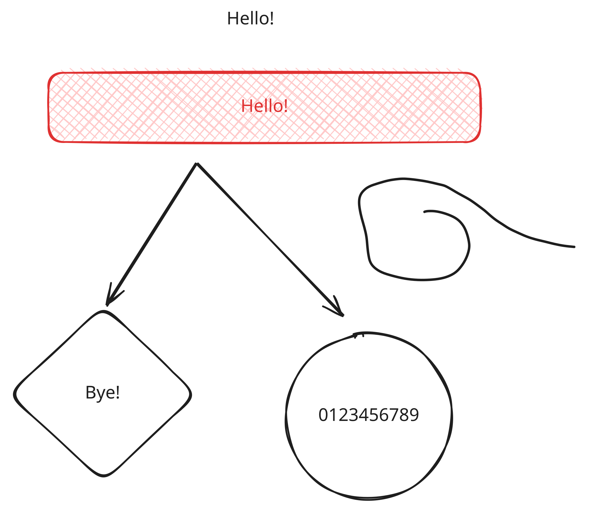

Here is a sample of some basic Markdown syntax that can be used when writing Markdown content in Astro.

```gleam
import wibble/wobble.{wubble}

pub fn main() {
  use woo <- wubble(0, 1, 2, #(0, 1))
  todo as "wow wow"  // [!code --]
  todo as "wow"  // [!code ++]
  todo as "wow"  // [!code ++]
}

pub fn webble() {
  echo "hello" // [!code highlight]
}
```

:+1:

## Headings

The following HTML `<h1>`—`<h6>` elements represent six levels of section headings. `<h1>` is the highest section level while `<h6>` is the lowest.

# H1

## H2

### H3

#### H4

##### H5

###### H6

## Paragraph

Xerum, quo qui aut unt expliquam qui dolut labo. Aque venitatiusda cum, voluptionse latur sitiae dolessi aut parist aut dollo enim qui voluptate ma dolestendit peritin re plis aut quas inctum laceat est volestemque commosa as cus endigna tectur, offic to cor sequas etum rerum idem sintibus eiur? Quianimin porecus evelectur, cum que nis nust voloribus ratem aut omnimi, sitatur? Quiatem. Nam, omnis sum am facea corem alique molestrunt et eos evelece arcillit ut aut eos eos nus, sin conecerem erum fuga. Ri oditatquam, ad quibus unda veliamenimin cusam et facea ipsamus es exerum sitate dolores editium rerore eost, temped molorro ratiae volorro te reribus dolorer sperchicium faceata tiustia prat.

Itatur? Quiatae cullecum rem ent aut odis in re eossequodi nonsequ idebis ne sapicia is sinveli squiatum, core et que aut hariosam ex eat.

## Images

### Syntax

```markdown

```

### Output


<!--  -->

## Blockquotes

The blockquote element represents content that is quoted from another source, optionally with a citation which must be within a `footer` or `cite` element, and optionally with in-line changes such as annotations and abbreviations.

### Blockquote without attribution

#### Syntax

```markdown
> Tiam, ad mint andaepu dandae nostion secatur sequo quae.  
> **Note** that you can use _Markdown syntax_ within a blockquote.
```

#### Output

> Tiam, ad mint andaepu dandae nostion secatur sequo quae.  
> **Note** that you can use _Markdown syntax_ within a blockquote.

### Blockquote with attribution

#### Syntax

```markdown
> Don't communicate by sharing memory, share memory by communicating.<br>
> — <cite>Rob Pike[^1]</cite>
```

#### Output

> Don't communicate by sharing memory, share memory by communicating.<br>
> — <cite>Rob Pike[^1]</cite>

> Don't communicate by sharing memory, share memory by communicating.<br>
> — <cite>Rob Pike[^1]</cite>

[^1]: The above quote is excerpted from Rob Pike's [talk](https://www.youtube.com/watch?v=PAAkCSZUG1c) during Gopherfest, November 18, 2015.

## Tables

### Syntax

```markdown
| Italics   | Bold     | Code   |
| --------- | -------- | ------ |
| _italics_ | **bold** | `code` |
```

### Output

<div class="table-wrapper">

| Italics   | Bold     | Code   |
| --------- | -------- | ------ |
| _italics_ | **bold** | `code` |

</div>

<div class="table-wrapper">

| Italics   | Bold     | Code   | smth quite long | smth quite long | smth quite long | smth quite long | smth quite long | smth quite long | smth quite long | smth quite long | smth quite long | smth quite long | smth quite long | smth quite long |
| --------- | -------- | ------ | --------------- | --------------- | --------------- | --------------- | --------------- | --------------- | --------------- | --------------- | --------------- | --------------- | --------------- | --------------- |
| _italics_ | **bold** | `code` | smth quite long | smth quite long | smth quite long | smth quite long | smth quite long | smth quite long | smth quite long | smth quite long | smth quite long | smth quite long | smth quite long | smth quite long |

</div>

## Code Blocks

### Syntax

we can use 3 backticks ``` in new line and write snippet and close with 3 backticks on new line and to highlight language specific syntax, write one word of language name after first 3 backticks, for eg. html, javascript, css, markdown, typescript, txt, bash

````markdown
```html
<!doctype html>
<html lang="en">
  <head>
    <meta charset="utf-8" />
    <title>Example HTML5 Document</title>
  </head>
  <body>
    <p>Test</p>
  </body>
</html>
```
````

### Output

```html
<!doctype html>
<html lang="en">
  <head>
    <meta charset="utf-8" />
    <title>Example HTML5 Document</title>
  </head>
  <body>
    <p>Test</p>
  </body>
</html>
```

## List Types

### Ordered List

#### Syntax

```markdown
1. First item
2. Second item
3. Third item
```

#### Output

1. First item
2. Second item
3. Third item

### Unordered List

#### Syntax

```markdown
- List item
- Another item
- And another item
```

#### Output

- List item
- Another item
- And another item

### Nested list

#### Syntax

```markdown
- Fruit
  - Apple
  - Orange
  - Banana
- Dairy
  - Milk
  - Cheese
```

#### Output

- Fruit
  - Apple
  - Orange
  - Banana
- Dairy
  - Milk
  - Cheese

## Other Elements — abbr, sub, sup, kbd, mark

### Syntax

```markdown
<abbr title="Graphics Interchange Format">GIF</abbr> is a bitmap image format.

H<sub>2</sub>O

X<sup>n</sup> + Y<sup>n</sup> = Z<sup>n</sup>

Press <kbd>CTRL</kbd> + <kbd>ALT</kbd> + <kbd>Delete</kbd> to end the session.

Most <mark>salamanders</mark> are nocturnal, and hunt for insects, worms, and other small creatures.
```

### Output

<abbr title="Graphics Interchange Format">GIF</abbr> is a bitmap image format.

H<sub>2</sub>O

X<sup>n</sup> + Y<sup>n</sup> = Z<sup>n</sup>

Press <kbd>CTRL</kbd> + <kbd>ALT</kbd> + <kbd>Delete</kbd> to end the session.

Most <mark>salamanders</mark> are nocturnal, and hunt for insects, worms, and other small creatures.
`%`

## Tasks

- [ ] Hello
- [x] Bye!

## H!

```gleam
import gleam/io.{println}

pub fn main() {
  println("Hello!") // [!code focus]
}
```

> [!NOTE]
> Useful information that users should know, even when skimming content.

> [!TODO]
> Useful information that users should know, even when skimming content.

> [!TIP]
> Helpful advice for doing things better or more easily.

> [!IMPORTANT]
> Key information users need to know to achieve their goal.

> [!WARNING]
> Urgent info that needs immediate user attention to avoid problems.

> [!CAUTION]
> Advises about risks or negative outcomes of certain actions.

> [!EXAMPLE]
> Advises about risks or negative outcomes of certain actions.
